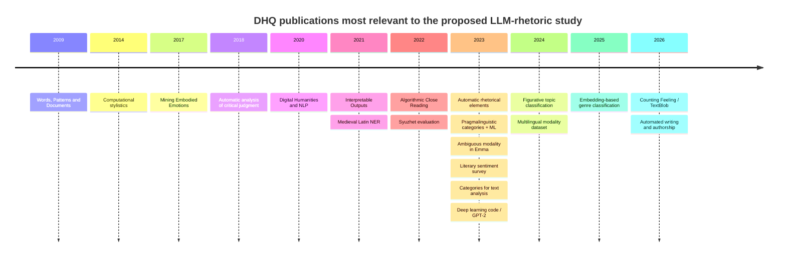

# DHQ-Only Deep Research Review: LLMs and Challenging Rhetorical Elements

## Executive summary

I screened *Digital Humanities Quarterly* (DHQ) specifically for work relevant to the proposed article **“Exploring the Potential of Large Language Models to Identify Challenging Rhetorical Elements.”** The search covered DHQ’s publication history from its 2007 beginning through the current published issue, **2026 Volume 20 Number 2**, and also screened the listed preview issue, **2026 Volume 20 Number 3**. DHQ’s archive exposes all of these issues as well as a journal-wide title index, which was used alongside semantic term searches and searches of DHQ’s official article-source repository. citeturn23view0turn23view3

After deduplication and removal of merely incidental matches, I retained **20 published DHQ articles** as materially relevant. My classification is:

| Category | Meaning | Articles |
|---|---|---:|
| **A** | Directly relevant: computational identification/analysis of rhetorical or figurative phenomena | **2** |
| **B** | Very close: ambiguity, discourse, semantic annotation/classification, interpretive linguistic phenomena | **6** |
| **C** | Methodologically relevant: NLP/ML evaluation, annotation, stylistics, sentiment, interpretability | **9** |
| **D** | Context/background: LLMs, AI, NLP, human-machine literary interpretation | **3** |
| **Total** | Published DHQ evidence set | **20** |

The single most important finding is that **DHQ has already published a paper extremely close to your research at the task level**:

> **Heyam Abd Alhadi, Ali Ahmad Hussein, and Tsvi Kuflik, “Automatic Identification of Rhetorical Elements in classical Arabic Poetry” (2023).**

That article automatically identifies **20 rhetorical elements** in Classical Arabic poetry using NLP plus expert-designed rules. It reports an overall **F-measure of 0.902** and explicitly describes the rule-based solution as an interim approach until enough annotated data exist for learned systems. The underlying REI project contained **26,925 poems**, while only a small number had been manually analyzed at that stage. citeturn23view0

This paper **must be central to your literature review**. It also helps define your novelty: you should **not** claim that automatic rhetorical-element identification is new to DHQ. Instead, your contribution can be that modern generative LLMs are evaluated systematically on the same broad class of expert-dependent rhetorical recognition problems. citeturn23view0

The second-closest DHQ paper is Gilad Gutman’s 2024 **“A Network Analysis of Figurative Topic Classification: The Case Study of *Timon of Athens*.”** It explicitly states that figurative rather than literal language creates special difficulties for NLP, constructs a training dataset of **1,388 manually identified figurative instances from four tragedies**, assigns those instances to **103 topics**, trains a topic classifier, and connects the resulting computational analysis back to literary close reading. Importantly, Gutman says that figurative instances still had to be extracted manually in his workflow. citeturn24view0

Those two papers establish the most important intellectual neighborhood for your study:

**existing DHQ work:** expert rules / supervised computational methods → rhetorical and figurative language  
**your possible contribution:** contemporary generative LLMs → difficult rhetorical recognition → expert gold standard → systematic comparative evaluation.

My archive screening did **not identify a published DHQ article that performs a multi-model benchmark of contemporary generative LLMs on a multi-class inventory of challenging rhetorical elements against an expert-adjudicated gold standard**. That is an inference from the archive-wide screening, not a claim made by DHQ itself. DHQ does publish LLM-focused work—for example, Hua and Raley’s GPT-2-centered *How to Do Things with Deep Learning Code*—but it is critical/model analysis rather than rhetorical-device classification. citeturn23view3turn24view1turn23view0

There is one important caution about the very latest material: DHQ’s official source repository contains an **unpublished/incomplete-publication-metadata manuscript** titled *Entity Extraction in Premodern German Administrative Documents: Accuracy and Cost in the Age of Generative AI*. The inspected source compares **GPT-4o** with Flair on historical German NER, but its volume, issue, and publication-date fields were blank in that source, so I did **not** count it as a published DHQ article. fileciteturn7file0L1-L2 This suggests that direct LLM-versus-traditional-NLP evaluation is moving into DHQ’s pipeline and strengthens the case for making your rhetorical study methodologically rigorous rather than merely demonstrative.

The three requested research files are complete:

- [Download `dhq_related_articles.csv`](sandbox:/mnt/data/dhq_related_articles.csv) — structured 20-paper dataset with all requested research fields.
- [Download `dhq_related_articles.md`](sandbox:/mnt/data/dhq_related_articles.md) — full DHQ-only literature review, methodology, ranking, timeline, gap analysis, and differentiation strategy.
- [Download `dhq_essential_articles.md`](sandbox:/mnt/data/dhq_essential_articles.md) — condensed must-cite set and recommended novelty positioning.

## Archive coverage and verification methodology

The search was deliberately broader than exact-title matching. DHQ’s own archive currently lists published issues from **2007 1.1 through 2026 20.2**, with **2026 20.3** shown separately as a preview. I traversed that issue structure and used DHQ’s full title index as the master bibliographic layer. citeturn23view0turn23view3

The semantic vocabulary was expanded across several families: **LLM, large language model, GPT, ChatGPT, AI, artificial intelligence, machine learning, deep learning, NLP, natural language processing, rhetoric, rhetorical, rhetorical elements, figurative language, metaphor, stylistics, style, discourse, pragmatics, ambiguity, modality, semantic analysis, annotation, classification, sentiment, emotion, interpretation, close reading, topic classification, text analysis, text mining, embeddings, and named-entity recognition**. The intention was to find conceptual and methodological predecessors rather than papers that happened to share words with your working title.

I also searched the official DHQ source repository. This proved important because terms such as “LLM” or “ChatGPT” can appear deep within an article even when the title does not mention AI. For example, the repository confirms that Hua and Raley’s 2023 article analyzes GPT-2 and large language models through Critical Code Studies. fileciteturn6file0L1-L2 It also shows that Tuuli Hongisto’s 2026 article on story-generation research explicitly situates contemporary LLMs within the longer history of computer-generated literature. fileciteturn3file0L1-L2

The inclusion threshold was intentionally stricter than “contains a relevant keyword.” An article remained in the dataset only when it materially informed at least one of the following: rhetorical/figurative recognition; difficult semantic or pragmatic classification; literary annotation; machine-learning/NLP evaluation; expert-versus-machine interpretation; methodological validation; or LLM/AI framing.

The categories in the dataset therefore mean:

**A — Direct:** automatic or computational treatment of rhetorical/figurative phenomena.

**B — Very close:** subtle semantic, discourse, ambiguity, classification, or annotation tasks with direct methodological transfer to rhetorical-element identification.

**C — Methodological:** ML/NLP evaluation, literary sentiment/stylistics, interpretability, annotation, or historical-language extraction useful for constructing a defensible experiment.

**D — Context:** LLM/AI/NLP or human-machine literary research that helps position the paper but is not a direct task predecessor.

The CSV contains the requested fields for every retained article: title, authors, year, volume/issue, article identifier, DHQ URL, DOI where re-verified, paraphrased abstract summary, keywords, category, 1–10 relevance score, relevance justification, relevant aspects, method, corpus, findings, metrics, limitations, open-access status, citation-count status, citation recommendation, and verification notes.

I deliberately **did not fabricate citation counts**. Citation counts are dynamic and can differ substantially among Google Scholar, Semantic Scholar, Crossref, OpenAlex, and other services. Because the user requested counts only “if verifiable,” the dataset records them as not independently verified rather than mixing incomparable sources.

Likewise, the `abstract` field contains **paraphrased abstract summaries**, rather than reproducing publishers’ full abstracts verbatim.

## Literature synthesis and the papers that matter most

The DHQ evidence divides naturally into a few methodological traditions that converge on your problem.

**Automatic rhetoric and figurative language.** The 2023 Arabic-rhetoric paper is effectively your immediate predecessor. It describes the manual identification of rhetorical elements as both time-consuming and expertise-intensive, identifies the absence of a sufficiently large annotated corpus as the obstacle to machine learning, and builds a rule-based framework around 20 elements. The authors explicitly acknowledge false positives, false negatives, and widely differing success rates among rhetorical elements. citeturn23view0 This is extraordinarily useful for your project because modern LLMs potentially change precisely the bottleneck that article faced: they can attempt zero-shot/few-shot classification before a large task-specific training corpus exists.

The 2024 *Timon of Athens* study attacks a neighboring problem from another direction. Gutman emphasizes that figurative expressions pose special computational problems because their meaning does not behave like straightforward literal language. His approach combines topic classification and network analysis, but he first manually identifies figurative instances; the training material comprises 1,388 such instances in four tragedies, grouped into 103 topics. citeturn24view0 That creates a second obvious research question for your paper: **can an LLM perform the earlier human-dependent identification step reliably, particularly when the figurative cue is subtle rather than explicit?**

**Ambiguity and category construction.** Bender, Becker, Kiemes, and Müller’s 2023 paper explicitly operates at the interface of interpretive pragmalinguistic annotation and machine learning, focusing on the detection and classification of discourse-referencing routines in political debates. citeturn23view1 It is methodologically close because rhetorical categories are not “natural labels” sitting transparently in the text; researchers have to define and operationalize them before a classifier can be judged.

Zirker and Göggelmann’s *Emma* case study may be even more important for one word in your title: **challenging**. It examines the ambiguous modality of *must* using close-reading-derived annotation criteria and studies where human annotators encounter difficulties. citeturn23view2 This suggests that your paper should not simply label certain examples “hard.” Difficulty should become an **empirical variable**, perhaps based on human disagreement, expert confidence, adjudication requirements, context dependency, or controlled transformations.

Bermúdez-Sabel and Dell’Oro’s 2024 multilingual modality dataset provides a further model for expert annotation. It encodes semantically rich modal information across Greek and Latin materials and is directly relevant to constructing a reusable, layered gold-standard dataset instead of a one-off list of test sentences. citeturn24view3

**Evaluation and tool criticism.** Simone Rebora’s 2023 *Sentiment Analysis in Literary Studies. A Critical Survey* matters because subtle literary classification suffers from construct-validity problems: software output can appear precise even when the category being measured is theoretically unstable or difficult for humans themselves to agree on. The survey examines sentiment techniques ranging from established tools to transformer pipelines and argues for more critical validation of computational literary analysis. citeturn24view2 This transfers directly to rhetoric: a model’s 90% “accuracy” means little if the gold labels are poorly defined or if several expert readings are legitimately possible.

Similarly, DHQ’s earlier and newer work on sentiment, stylistics, interpretability, and machine learning makes it clear that a successful digital-humanities paper should not stop at the application of a tool. The stronger question is what the computational method reveals, where it breaks, how its categories relate to humanities concepts, and how reproducible its output is. DHQ’s title index confirms the continuity of this methodological tradition from *Words, Patterns and Documents: Experiments in Machine Learning and Text Analysis* in 2009 through recent work on embeddings, affect, classification, and LLM-related literary studies. citeturn23view3

**LLMs themselves.** Hua and Raley’s *How to Do Things with Deep Learning Code* is the key DHQ-native LLM-context citation. Its premise is that scholars need a substantive understanding of how language models function, and it uses GPT-2 applications to investigate deep-learning systems through Critical Code Studies. citeturn24view1 For your article, that means model names and API calls should not be treated as interchangeable black boxes: model version, date, prompt configuration, sampling parameters, and possibly system-level differences should be documented.

Taken together, the literature suggests that your strongest DHQ paper is not:

> “We asked an LLM to identify rhetorical figures and it did reasonably well.”

It is closer to:

> **“We construct an expert-adjudicated benchmark of genuinely challenging rhetorical phenomena, evaluate contemporary LLMs under controlled zero-shot and few-shot conditions, compare them with prior computational approaches, and analyze where and why model judgments diverge from expert rhetorical interpretation.”**

That framing is much closer to the methodological expectations established by the DHQ articles above. citeturn23view0turn24view0turn23view1turn23view2turn24view2

## Ranked DHQ evidence base and publication timeline

The ranking below is my analytical relevance assessment, not a ranking supplied by DHQ. Scores indicate closeness to **your proposed research question**, not article quality.

| Rank | DHQ article | Publication | Category | Relevance | Citation recommendation |
|---:|---|---|:---:|---:|---|
| **1** | **Automatic Identification of Rhetorical Elements in classical Arabic Poetry** — Abd Alhadi, Hussein & Kuflik citeturn23view0 | 2023, 17(2) | **A** | **10.0** | **Essential** |
| **2** | **A Network Analysis of Figurative Topic Classification: The Case Study of *Timon of Athens*** — Gutman citeturn24view0 | 2024, 18(3) | **A** | **9.5** | **Essential** |
| **3** | **Category Development at the Interface of Interpretive Pragmalinguistic Annotation and Machine Learning** — Bender, Becker, Kiemes & Müller citeturn23view1turn23view3 | 2023, 17(3) | **B** | **9.1** | **Essential** |
| **4** | **Case Study: Annotating the ambiguous modality of “must” in Jane Austen’s *Emma*** — Zirker & Göggelmann citeturn23view2 | 2023, 17(3) | **B** | **9.0** | **Essential** |
| **5** | **An Annotated Multilingual Dataset to Study Modality in the Gospels** — Bermúdez-Sabel & Dell’Oro citeturn24view3 | 2024, 18(1) | **B** | **8.6** | Strong candidate |
| **6** | **Toward an Automatic Analysis of Critical Judgment: Modified Quotes in the Literary Discourse of the Nineteenth Century** — Riguet & Alrahabi citeturn23view3 | 2018, 12(1) | **B** | **8.4** | Strong candidate |
| **7** | **Algorithmic Close Reading: Using Semantic Triplets to Index and Analyze Agency in Holocaust Testimonies** — Fan & Presner citeturn23view3 | 2022, 16(3) | **B** | **8.3** | Strong candidate |
| **8** | **Genre 2.0? Embedding-Based Cluster Analysis as a Tool for Text Classification in Medieval Hebrew Literature** — Fuchs citeturn23view3 | 2025, 19(3) | **B** | **8.1** | Strong candidate |
| **9** | **Sentiment Analysis in Literary Studies. A Critical Survey** — Rebora citeturn24view2 | 2023, 17(2) | **C** | **8.0** | **Essential** |
| **10** | **How to Do Things with Deep Learning Code** — Hua & Raley citeturn24view1 | 2023, 17(2) | **D** | **7.9** | Strong candidate |
| **11** | **Working on and with Categories for Text Analysis: Challenges and Findings from and for Digital Humanities Practices** — Gerstorfer, Gius & Jacke citeturn23view3 | 2023, 17(3) | **C** | **7.8** | Strong candidate |
| **12** | **Interpretable Outputs: Criteria for Machine Learning in the Humanities** — Dobson citeturn23view3 | 2021, 15(2) | **C** | **7.8** | Strong candidate |
| **13** | **Counting Feeling: Affect Theory and Sentiment Analysis in TextBlob** — Moro citeturn23view3 | 2026, 20(1) | **C** | **7.7** | Strong candidate |
| **14** | **Sentiment Analysis: Limits and Progress of the Syuzhet Package and Its Lexicons** — Kim citeturn23view3 | 2022, 16(2) | **C** | **7.4** | Strong candidate |
| **15** | **Computational Stylistic Analysis of Popular Songs of Japanese Female Singer-songwriters** — Suzuki & Hosoya citeturn23view3 | 2014, 8(1) | **C** | **7.2** | Background |
| **16** | **Mining Embodied Emotions: A Comparative Analysis of Sentiment and Emotion in Dutch Texts, 1600–1800** — Leemans et al. citeturn23view3 | 2017, 11(4) | **C** | **7.1** | Background |
| **17** | **A Named Entity Recognition Model for Medieval Latin Charters** — Chastang, Torres Aguilar & Tannier citeturn23view3 | 2021, 15(4) | **C** | **6.9** | Background |
| **18** | **Words, Patterns and Documents: Experiments in Machine Learning and Text Analysis** — Argamon & Olsen citeturn23view3 | 2009, 3(2) | **C** | **6.8** | Background |
| **19** | **Digital Humanities and Natural Language Processing: “Je t’aime... Moi non plus”** — McGillivray, Poibeau & Ruiz Fabo citeturn23view3 | 2020, 14(2) | **D** | **6.8** | Background |
| **20** | **Striving towards automated writing – Views on authorship in story generation research** — Hongisto fileciteturn3file0L1-L2 | 2026, 20(1) | **D** | **6.2** | Background |

The resulting chronology is revealing. Computational text analysis appears in the DHQ evidence set as early as 2009, but the concentration around **2023–2026** reflects the convergence of annotation studies, machine learning, transformers, figurative-language analysis, and LLM-oriented work. DHQ’s current archive and title index confirm that this is now an active rather than peripheral methodological area. citeturn23view0turn23view3

The **minimum DHQ-specific citation core** I would build your article around is therefore:

**Abd Alhadi, Hussein & Kuflik 2023 → Gutman 2024 → Zirker & Göggelmann 2023 → Bender et al. 2023 → Rebora 2023**, supplemented by **Hua & Raley 2023**, **Bermúdez-Sabel & Dell’Oro 2024**, **Dobson 2021**, and **Fan & Presner 2022** according to space and methodology. Their roles differ: the first two establish the closest task/phenomenon precedents; the next two establish annotation/category methodology; Rebora and Dobson establish validation and interpretability; Hua and Raley provide LLM-critical framing; and Fan and Presner connect computational extraction back to humanities interpretation. citeturn23view0turn24view0turn23view2turn23view1turn24view2turn24view1turn24view3

## Research gap and how your article should differentiate itself

The answer to **“Has DHQ already published something very close to our question?”** is:

**Yes at the rhetorical-computation level; no at the modern-LLM benchmark level found in this published-archive screening.**

That distinction is crucial.

The 2023 paper already demonstrates that automatic identification of rhetorical elements in Classical Arabic poetry is possible and evaluates 20 elements quantitatively. It even describes machine learning as the logical future direction once annotation becomes sufficient. citeturn23view0 Therefore a paper whose novelty is merely “using AI instead of rules” will look incremental.

Gutman’s 2024 paper additionally demonstrates that figurative language can be computationally operationalized through machine learning and that the results can contribute to literary interpretation, while simultaneously showing that expert manual intervention is still necessary at important stages. citeturn24view0

Your paper becomes substantially stronger when the research question shifts from:

> **Can LLMs identify rhetorical elements?**

to something like:

> **How reliably can contemporary large language models identify genuinely challenging rhetorical elements, relative to expert human judgments, and what linguistic or interpretive properties predict their success and failure?**

That turns the project from an application demonstration into an **evaluation study with a humanities research contribution**.

The most defensible differentiators are these:

**Use several LLMs.** A single ChatGPT experiment would be vulnerable to being interpreted as a product case study. Compare multiple model families where feasible, and record the exact model/version and evaluation date. DHQ’s critical LLM work provides a strong reason not to treat “the LLM” as a single stable object. citeturn24view1

**Make “challenging” measurable.** Create levels such as clear, moderately ambiguous, and highly challenging. Difficulty can be estimated from expert disagreement, confidence, required context, adjudication time, competing plausible labels, or controlled adversarial modifications. The *Emma* modality study is an excellent DHQ precedent for treating ambiguity as something to investigate rather than merely asserting it. citeturn23view2

**Build an expert-adjudicated gold standard.** Ideally use at least two rhetorical specialists independently, calculate inter-annotator agreement, and adjudicate disagreements. Some cases may legitimately admit more than one rhetorical analysis; your annotation scheme should allow this rather than forcing false certainty. Bender et al. and the multilingual modality project offer useful models for turning interpretive categories into systematic annotation schemes. citeturn23view1turn24view3

**Evaluate rhetorical elements separately.** The 2023 DHQ paper explicitly notes substantially different success rates by rhetorical element despite a strong overall F-measure. citeturn23view0 Your study should therefore report **per-element precision, recall, and F1**, plus macro-F1, rather than relying mainly on overall accuracy.

**Evaluate the evidence span.** Ask the LLM not only “what rhetorical figure is present?” but also “which exact words realize it?” Label accuracy and evidence-span accuracy should be separate measurements. This is particularly important for metaphors, puns, antithesis, repetitions, and phenomena whose rhetorical force arises from relations between several textual spans.

**Evaluate the explanation separately from the label.** A model can accidentally give the correct category while explaining it incorrectly. For rhetorical scholarship, that distinction matters. A useful evaluation scheme could therefore have three layers: **classification correctness, textual-evidence correctness, and rationale/interpretive correctness**. DHQ’s literature on interpretability and critical literary NLP strongly supports such a design. citeturn24view2turn23view3

**Include a conventional baseline.** The strongest experiment would not compare only GPT vs Claude vs Gemini. It should include a rule-based or simpler supervised baseline where technically possible—especially because DHQ’s 2023 rhetorical paper already gives you a natural historical comparator. citeturn23view0

**Test prompt sensitivity and repeated runs.** Compare zero-shot and few-shot conditions, record prompt templates, and repeat nondeterministic evaluations. An LLM that scores 90% with one carefully optimized prompt but 75% after small prompt changes should not be described as simply having 90% rhetorical competence.

**Analyze errors rhetorically, not only statistically.** Build an error taxonomy such as: surface-cue overreliance; missed implicit metaphor; literal-versus-figurative confusion; overlapping figures; cultural-knowledge failure; context-window failure; lexical ambiguity; false rhetorical inference; terminology mismatch; and cases where experts themselves disagree. This is where a DHQ paper can contribute something beyond a standard NLP leaderboard.

**Consider cross-linguistic rhetoric.** This is particularly attractive because DHQ’s most direct rhetorical predecessor is based on **Classical Arabic**, while its recent work includes multilingual semantic annotation and computational classification of Hebrew literature. citeturn23view0turn24view3turn23view3 A well-designed Arabic–English comparison, for example, could ask whether LLM rhetorical performance depends on linguistic/cultural representation in training data rather than treating rhetorical competence as universally homogeneous.

**Release reproducibility artifacts.** Annotation guidelines, difficulty criteria, model names and versions, prompts, raw outputs, scoring code, adjudication rules, and the dataset—or legally shareable item identifiers—would significantly strengthen the work. This is especially important because hosted LLM behavior can change over time.

A publication-positioning paragraph could therefore say:

> **Building on DHQ’s prior work on rule-based automatic identification of Classical Arabic rhetorical elements and computational classification of figurative language, this study evaluates whether contemporary generative large language models can identify expert-defined rhetorical phenomena under controlled levels of interpretive difficulty. Rather than treating LLM output as self-validating, we compare models against an independently annotated and adjudicated gold standard, report per-phenomenon performance, and analyze the linguistic and rhetorical sources of model error.**

That positioning is supported by the actual DHQ record and avoids overstating novelty. citeturn23view0turn24view0turn23view1turn23view2

I would also seriously consider refining the working title. **“Exploring the Potential…”** sounds exploratory and potentially descriptive. Based on the gap uncovered here, a stronger article could be titled:

> **Evaluating Large Language Models for the Identification of Challenging Rhetorical Elements**

or, if the human benchmark becomes central:

> **Can Large Language Models Identify Challenging Rhetorical Elements? An Expert-Annotated Evaluation**

The latter more clearly advertises the feature that would differentiate your work from DHQ’s existing rule-based and classifier-based studies.

## Deliverables and limitations

The complete structured dataset is available here:

**[Download `dhq_related_articles.csv`](sandbox:/mnt/data/dhq_related_articles.csv)**

It contains **20 rows** and the requested structured fields, including methods, corpora, findings, metrics where re-verified, limitations, relevance scores, recommendations, and verification notes.

The full literature review is available here:

**[Download `dhq_related_articles.md`](sandbox:/mnt/data/dhq_related_articles.md)**

It contains the DHQ-only literature synthesis, screening methodology, ranked evidence table, Mermaid timeline, gap analysis, and differentiation recommendations.

The condensed article-selection document is available here:

**[Download `dhq_essential_articles.md`](sandbox:/mnt/data/dhq_essential_articles.md)**

It isolates the must-cite papers and explains precisely why each matters for your proposed article.

The main limitation is deliberate rather than accidental: the final set is an **analytically screened relevance corpus**, not every DHQ article in which a generic word such as “model,” “language,” “rhetoric,” or “AI” occurs. DHQ’s complete issue structure and title index were screened, and repository searches were used to catch hidden LLM/AI references, but weak and incidental matches were excluded. citeturn23view0turn23view3

A second limitation concerns bibliometrics: citation counts were not inserted because I could not establish one consistent, authoritative, time-stamped citation index for all 20 papers without mixing incompatible services. The dataset therefore says **“Not independently verified”** rather than inventing precision.

A third concerns forthcoming material. The official repository contains at least one highly relevant generative-AI manuscript comparing GPT-4o with a traditional NLP model, but because the inspected source contained blank publication metadata, I excluded it from the published-DHQ corpus. fileciteturn7file0L1-L2 The published-literature conclusion should therefore be dated to this research snapshot, **October 7, 2026**.

The central conclusion remains robust: **your idea is viable for DHQ, but the novelty is not “automatic rhetoric.” The compelling gap is a rigorous, expert-grounded evaluation of contemporary LLMs on genuinely difficult rhetorical phenomena.** DHQ’s own literature gives you unusually strong predecessors against which to frame that contribution: rule-based rhetorical identification, supervised figurative classification, ambiguity-sensitive annotation, category construction, literary-NLP validation, interpretability, and critical analysis of language models. citeturn23view0turn24view0turn23view2turn23view1turn24view2turn24view1