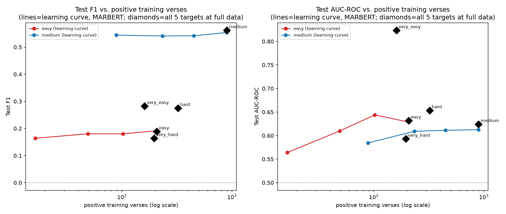

# Phase 5 Local-FT Diagnosis — why did the LLM-easy targets get the worst fine-tuned F1?

**Scope**: diagnosis-only, no new labeling, no paid API calls (all GPU work is local, zero
cost). Reads `experiments/phase5_local_ft/` + `results/phase5_local_ft/raw/*.json` (the
existing, frozen Phase 5 grid) without editing either. New code:
`experiments/phase5_local_ft/analysis/` (6 section scripts + `common.py`). New data outputs:
`results/phase5_local_ft/analysis/*.{md,json}` (full tables — this document summarizes and
interprets them; see those files for every row). New training: Section 4 only (24 local
runs, MARBERT, no weights saved to disk, same discipline as the main Phase 5 grid). Figure:
`docs/phase5/figs/section4_learning_curve.png`.

Terminology (`GLOSSARY.md`): طباق=antithesis, كناية=periphrasis, مجاز (incl. استعارة)=
trope/metaphor.

---

## The question

[`LOCAL_FT_RESULTS.md`](LOCAL_FT_RESULTS.md) §7 found that fine-tuned-model F1 does not track
LLM-based difficulty at all: the two targets the LLMs (Phase 1 + Phase 3) found **easiest** —
تشبيه مطول (very_easy) and استعارة تمثيلية (easy) — are the fine-tuned classifiers' **worst**
two, while استعارة فعل (medium for the LLMs) is by far the fine-tuned models' best. That
section reported a Pearson r=0.996 between each target's corpus-wide positive-verse count and
its mean S2 F1, and concluded "this is a data-volume story, not a rhetorical-subtlety story."
This document re-examines that conclusion with exact numbers, variance, a real (not just
correlational) data-size experiment, signal inspection, and distribution-shift checks — and
finds the full picture is more specific than "more data = better F1."

---

## 1. Exact numbers

Full table (all 3 splits x 5 targets x 3 models x baselines x LLM evidence):
[`results/phase5_local_ft/analysis/section1_main_table.md`](../../results/phase5_local_ft/analysis/section1_main_table.md).
Generated by `experiments/phase5_local_ft/analysis/section1_main_table.py`.

**No cell has test_pos < 30** — the smallest is very_easy/S2 (mean test_pos ~33 across the 3
seeds' own, differently-shuffled test sets); medium/S3 has the largest margin (test_pos=127,
fixed). The "thin, n<30" flag defined for this task never fires anywhere in the grid, so test
support is not, by itself, the bottleneck at evaluation time (train support is a different
question — see §4).

S2 (primary split), condensed — full per-seed TP/FP/FN/TN and train/val/test pos/neg
verse+poem counts are in the linked table:

| Level (subtype) | Model | P | R | F1 mean±std | threshold | best epoch |
|---|---|---|---|---|---|---|
| very_easy (تشبيه مطول) | camelbert_ca | 0.073 | 0.418 | 0.096±0.049 | 0.55±0.07 | 2.0±0.0 |
| very_easy | arabert_v2 | 0.056 | 0.397 | 0.097±0.026 | 0.50±0.05 | 2.0±0.8 |
| very_easy | **marbert** | 0.296 | 0.285 | **0.282±0.090** | 0.79±0.12 | 2.7±0.5 |
| easy (استعارة تمثيلية) | camelbert_ca | 0.075 | 0.354 | 0.120±0.038 | 0.53±0.04 | 2.0±1.4 |
| easy | arabert_v2 | 0.087 | 0.570 | 0.148±0.034 | 0.56±0.04 | 3.0±0.8 |
| easy | **marbert** | 0.139 | 0.401 | **0.189±0.023** | 0.40±0.12 | 3.0±2.2 |
| medium (استعارة فعل) | camelbert_ca | 0.380 | 0.969 | 0.546±0.006 | 0.47±0.06 | 3.3±2.6 |
| medium | arabert_v2 | 0.376 | 0.968 | 0.542±0.006 | 0.43±0.03 | 3.0±0.8 |
| medium | **marbert** | 0.405 | 0.919 | **0.562±0.008** | 0.26±0.09 | 2.0±0.8 |
| hard (طباق إيجاب) | camelbert_ca | 0.119 | 0.584 | 0.175±0.072 | 0.47±0.06 | 3.3±0.9 |
| hard | arabert_v2 | 0.143 | 0.911 | 0.246±0.027 | 0.42±0.03 | 3.7±2.5 |
| hard | **marbert** | 0.246 | 0.351 | **0.275±0.053** | 0.80±0.12 | 5.3±2.1 |
| very_hard (كناية عن فعل) | **camelbert_ca** | 0.131 | 0.661 | **0.217±0.020** | 0.56±0.02 | 2.3±1.2 |
| very_hard | arabert_v2 | 0.108 | 0.422 | 0.172±0.015 | 0.56±0.09 | 3.0±2.8 |
| very_hard | marbert | 0.149 | 0.272 | 0.164±0.007 | 0.51±0.30 | 2.7±0.5 |

TF-IDF+LR baseline (S2) is a real competitor, not a strawman: 0.268 on very_easy (**beats all
3 BERT models**), 0.166 on easy (beats 2/3), 0.543 on medium (within 2pts of best BERT and
barely above always-positive 0.548), 0.227 on hard, 0.158 on very_hard. always-positive alone
gets 0.548 F1 on medium — this single number already hints that medium's apparent "win" is
partly a base-rate artifact, confirmed in §3.

LLM evidence is reported with units kept explicit and never conflated: only استعارة فعل has a
true verse-level LLM F1 (0.576 best single model / 0.568 ensemble, from E1 v2, same TEST pool
as this phase's S3). For the other 4 targets, "LLM evidence" is either Phase 3's span-level
strict **recall** (not F1) or Phase 1's parent-level (not subtype-level) span F1 — both
different metrics on a different unit of analysis (span match, not verse-level binary), so
"LLM found this target easy" throughout this document means "high span-level recall / low
%-missed," not a directly comparable F1 number.

---

## 2. Variance — which differences are real?

Full table: [`section2_variance.md`](../../results/phase5_local_ft/analysis/section2_variance.md).
Bootstrap 95% CI over poems (2000 resamples, pooled across the 3 seeds' predictions — same
method as Phase 5's own `analyze.py`), per target x model, plus a pooled-across-3-models
per-target CI and pairwise overlap check.

**Pooled (3 models) S2 point F1 and 95% CI per target:**

| Target | Point F1 | 95% CI |
|---|---|---|
| very_easy | 0.127 | [0.086, 0.166] |
| easy | 0.157 | [0.099, 0.219] |
| medium | 0.550 | [0.496, 0.596] |
| hard | 0.245 | [0.197, 0.291] |
| very_hard | 0.192 | [0.131, 0.252] |

**Pairwise CI overlap (= NOT statistically distinguishable at this sample size):**

- very_easy vs easy — **overlap** (not distinguishable)
- very_easy vs very_hard — **overlap** (not distinguishable)
- easy vs hard — **overlap** (not distinguishable)
- easy vs very_hard — **overlap** (not distinguishable)
- hard vs very_hard — **overlap** (not distinguishable)
- medium vs every other target — **no overlap** (medium is cleanly, robustly the best)

So part of the "reversal" is smaller than it first looks: **easy is not statistically
distinguishable from either hard or very_hard**, and **very_easy is not statistically
distinguishable from very_hard**. The one rock-solid, high-confidence claim in this grid is
"medium beats everything else" — not a clean 5-way difficulty ordering. Seed-to-seed F1 std
(3 seeds) is largest for hard/camelbert_ca (0.072) and very_easy/marbert (0.090) — another
reason not to over-read any single run's number, consistent with the project's standing
2-run/CLAUDE.md discipline.

---

## 3. Is the model learning at all?

Full table: [`section3_learning_diagnosis.md`](../../results/phase5_local_ft/analysis/section3_learning_diagnosis.md).
`val loss` was never recorded by `train.py` (only val F1, via threshold search) — noted
rather than invented. AUC-ROC / average precision are threshold-free; "best-possible-threshold
F1" picks the threshold that maximizes F1 **on the test set itself** — a diagnostic ceiling
only, never a valid reported result (it is never used as a result anywhere else in this
project).

**AUC-ROC on test, S2, pooled 3 seeds:**

| Target | camelbert_ca | arabert_v2 | marbert |
|---|---|---|---|
| very_easy | 0.569 | 0.473 (below chance) | **0.790** |
| easy | 0.492 (chance) | 0.534 | 0.562 |
| medium | 0.511 (chance) | 0.517 (chance) | 0.619 |
| hard | 0.462 (below chance) | 0.507 (chance) | 0.650 |
| very_hard | 0.543 | 0.525 | 0.586 |

**This is the central finding of this diagnosis.** Two of the three models (camelbert_ca,
arabert_v2) show AUC-ROC at or below 0.5 — chance-level ranking ability — on 4 of 5 targets,
**including medium**, the target with the best F1. Medium's good F1 for these two models is
substantially a **threshold/base-rate artifact**, not real discrimination: pred_rate (share
predicted positive) is 0.967 (camelbert_ca) / 0.974 (arabert_v2) against a true rate of 0.378
— both models say "yes" on medium almost every time, and F1 rewards that heavily at 38%
prevalence (always-positive alone scores 0.548 there, per §1). MARBERT is the only model with
consistently above-chance AUC across all 5 targets (0.562–0.790) — real, if modest, learning.

**MARBERT's own AUC ranking inverts the F1 ranking**: very_easy (AUC=0.790) is MARBERT's
**best**-discriminating target, clearly ahead of medium (0.619), hard (0.650), very_hard
(0.586), and easy (0.562) — yet very_easy has MARBERT's **worst** real F1 (0.282, tied for
worst with easy at 0.189). Average precision confirms the same story at a smaller scale
(very_easy AP=0.287 vs. true-rate 0.064 — a ~4.5x lift over the random-guessing baseline,
the largest relative lift of any target/model cell in the grid). The model can tell
تشبيه مطول verses apart from non-تشبيه مطول verses better than it can tell any other
target apart — it just can't do it at a single F1-optimal threshold under ~6% prevalence
with only ~33 positive test verses, because a handful of ranking mistakes near the threshold
swings F1 by a large relative amount at that scale. **The diagnosis for very_easy specifically
is "threshold/imbalance", not "not learning" — directly matching the pattern this task asked
to distinguish.** Easy is more ambiguous: MARBERT's AUC there (0.562) is barely above chance,
so for easy the "not really learning" explanation carries more real weight than it does for
very_easy.

---

## 4. Data-size hypothesis — a real experiment, not just a 5-point correlation

Full numbers: [`section4_learning_curve.md`](../../results/phase5_local_ft/analysis/section4_learning_curve.md) +
[`section4_learning_curve.json`](../../results/phase5_local_ft/analysis/section4_learning_curve.json).
24 new local-only training runs (MARBERT, no API calls, no weights saved): easy
(استعارة تمثيلية) and medium (استعارة فعل), S2 val/test held fixed per seed, TRAIN
subsampled to nested 10/25/50/100% prefixes (same seed's own shuffle, so each fraction's set
is a superset of the smaller ones), 3 seeds x 4 fractions x 2 targets. ~16–30s/run on the RTX
3060 Ti; the whole experiment finished in under 10 minutes.

**Within-target curves are nearly flat — more data, within the range this corpus offers,
barely moves either target:**

| Target | train_pos (10%→100%) | F1 (10%→100%) | AUC (10%→100%) |
|---|---|---|---|
| easy | 16→208 (mean) | 0.164→0.180→0.180→0.192 | 0.564→0.610→0.644→0.629 |
| medium | 89→896 (mean) | 0.544→0.541→0.542→0.554 | 0.584→0.609→0.611→0.612 |

Medium's F1 is already at its ceiling (~0.54) with just ~90 positive training verses — a
**10x** increase to ~900 positives buys essentially nothing (0.544→0.554). Easy's F1 edges up
only slightly and noisily (0.164→0.192, within overlapping seed-to-seed noise). Power-law fits
(`F1 = a·x^b`) on the within-target points are near-flat and have essentially no explanatory
power (easy: b=0.031, R²=0.020; medium: b=0.006, R²=0.065) — **a flat line, not a learning
curve with real headroom**, for both targets in this 10–900-positive range.

**Cross-target (5 points, full data, MARBERT, S2):** Pearson r(F1, train_pos)=0.945 (p=0.015)
— close to Phase 5's originally-reported 0.996 (that number used corpus-wide positive counts
averaged across all 3 models; this one uses actual S2 train_pos for MARBERT only, so the two
are related but not identical quantities). A power-law fit does moderately well on F1 (R²=0.86,
b=0.59) — **but the same fit on AUC is the opposite story**: Pearson r(AUC, train_pos)=**−0.322**
(p=0.597, not significant, wrong sign), power-law R²=0.16. **Positive-training-verse count
predicts F1 reasonably well across targets, but does not predict AUC (real discrimination
ability) at all.**

**Why**: in this corpus, total verses per poem/split is roughly fixed, so a target's
corpus-wide positive-verse count is almost the same variable as its **prevalence** (pos_rate):
very_easy 6.3%, easy 8.3%, medium 36.3%, hard 13.1%, very_hard 8.1% — medium's "huge data
advantage" is mostly "medium has a near-balanced class split," not "medium's absolute training
set is bigger in some way that matters mechanically." The flat within-target learning curves
(§4, holding each target's own prevalence fixed while 10x-ing absolute count) directly confirm
this: **absolute positive count, holding prevalence fixed, has a weak effect; prevalence
itself (confounded with but distinct from raw count across targets) is what actually governs
F1 at a given threshold.** The "number of positives needed" framing in the original question
is therefore slightly the wrong question for F1 specifically — the evidence here points at
**imbalance severity**, not training-set size, as medium's real advantage. For AUC (the
cleaner "is it learning" signal), neither framing explains much: very_easy's AUC=0.790 with
only 151 corpus-wide positives is the best discrimination in the whole grid, which the
data-size story does not predict at all (see §5 for what does predict it: explicit lexical
markers, partially).

---

## 5. Signal hypothesis

Full detail: [`section5_signal.md`](../../results/phase5_local_ft/analysis/section5_signal.md).

**TF-IDF top features**: for very_easy (تشبيه مطول), the single highest-weight positive
character n-grams are `كأ`, `كأن`, `كال`, `كأنّ` — i.e., the logistic-regression baseline
has essentially rediscovered the simile markers كأنّ/كـ by itself from raw character
n-grams, with no linguistic knowledge built in. For easy (استعارة تمثيلية) the top features
are far less interpretable (`اثا`, `ثا`, generic short morphemes) — consistent with
استعارة تمثيلية being a semantic/structural device with no single reliable lexical marker.

**Explicit-marker check (تشبيه مطول)**: of 217 positive verses corpus-wide, only **40
(18.4%)** contain one of {كأنّ, كأن, مثل, كما, شبه, تشبه} — a real enrichment over the
corpus-wide baseline (4.2% of all verses contain one of these markers, a ~4.4x lift) but a
**minority** of positives. Markers are informative when present but do not cover most of the
target.

**Top-15 TP/FN verses (MARBERT, S2 seed0)** — the qualitative picture that explains the
marker-check number: most high-confidence true positives do contain كأنّ/كال/كما explicitly
(e.g. `كَالرِّئْمِ الْأَغَنْ`, `كأنَّها قَناةٌ تَعَلَّتْ`). But several of the most
confidently-**missed** false negatives *also* contain an explicit marker (e.g. `كَمَا مَالَ
فِيهَا الهَالِكُ`, prob=0.498; `كَأَنِّي أُنَادِي`, prob=0.454) — the model is not simply
"blind without a marker," it sometimes misses marker-bearing verses too, and several listed
span_texts visibly **span two verses of the same بيت** (sadr+ajuz), e.g. poem 3192 verse 27's
annotation reads across `وَالرِّجْلُ كَالرَّوْضَةِ المِحْلَالِ زَيَّنَهَا` **and** `نَبْتُ
الخَرِيفِ وَكَانَتْ قَبْلُ مِعْشَابَا`. تشبيه مطول ("extended simile") is, by its own name, a
device that can extend across clause/verse boundaries — the task's framing (one verse,
`MAX_LEN=32` tokens, classified independently) structurally cannot see the full span for at
least some instances, which is a **task-definition** mismatch, not purely a learning failure.

**Target co-occurrence** (corpus-wide, verse-level; full matrix in the linked file): medium's
positives overlap heavily with hard (47% of hard's positives are also medium) and very_hard
(43%), and moderately with both easy (34%) and very_easy (34%) — most verses carrying one
rhetorical figure in this corpus also carry others, so none of the 5 targets is being trained
on a "clean," single-figure-only positive set. This does not by itself explain the
easy-targets-worst pattern (overlap rates are broadly similar across targets, not concentrated
on the two worst ones) but is a real caveat for all 5 classifiers alike.

**Label-noise indicator**: 634 / 9,663 unique exact `span_text` strings (**6.56%**) are
annotated with more than one distinct subtype somewhere in the 166-poem corpus (e.g. the exact
phrase `ويَجْرَحُ` appears tagged as `استعارة فعل`, `كناية عن فعل`, and `مجاز عقلي` in
different occurrences — three different parent elements for the identical surface string).
This is a real, non-trivial annotation-inconsistency rate, but it is **not concentrated** on
the two easy-for-LLM targets specifically (the top-10 conflicted spans by subtype-count touch
a broad mix of elements) — label noise is a general caveat for the whole corpus, not a
specific explanation for why these two targets underperform.

---

## 6. Distribution shift

Full tables: [`section6_distribution_shift.md`](../../results/phase5_local_ft/analysis/section6_distribution_shift.md).

**Train/test poet overlap** (every split x seed): 76–88% of test poems have their poet also
present in train (e.g. S2 seed0: 20/25 = 80%). This is not a severe unseen-poet problem for
any split — most test poets are at least partly represented in training, though 3–8 test poems
per split/seed (12–24%) do come from a poet with zero training exposure.

**Positive-verse concentration** (corpus-wide, all 5 targets): top-5 poets hold 34–48% of each
target's positives (very_easy 47.0%, easy 47.0%, medium 43.1%, hard 48.2%, very_hard 34.3%) —
moderate concentration across **every** target alike, not specifically worse for the two
easy-for-LLM targets. Distinct-poem counts (85–156 poems carry at least one positive,
depending on target) rule out "positives are all crammed into a handful of poems" as a
target-specific explanation.

**Per-poet / per-period F1 on S2 test** (MARBERT, pooled 3 seeds): both easy-for-LLM targets
show large poet-to-poet and period-to-period F1 swings (e.g. very_easy: طرفة بن العبد F1=0.343
vs. أبو نواس F1=0.118; easy: جرير بن عطيّة F1=0.387 vs. طرفة بن العبد F1=0.082) — but this
variance is present for every target in the grid, not a distinguishing feature of the two
worst ones, and no single poet or period's exclusion would flip either target's aggregate F1
into a competitive range. Distribution shift is a real source of noise across the whole grid
but not the primary explanation for the easy-targets-worst pattern.

---

## 7. Ranked causes

1. **Class imbalance / decision-threshold dynamics (strongest, best-evidenced cause).**
   Medium's prevalence (36%) lets any model — even one with chance-level AUC — reach F1≈0.54
   by predicting positive often (§3: camelbert_ca/arabert_v2 AUC≈0.51 on medium, pred_rate
   0.97). The other 4 targets sit at 6–13% prevalence, where F1 punishes the same ranking
   quality far more harshly. This is confirmed, not just suggested, by §4's flat within-target
   learning curves (10x more data at fixed prevalence barely moves F1) and by the
   TF-IDF/always-positive baselines in §1 (always-positive alone scores 0.548 on medium).
2. **Metric choice obscures real learning for at least one target (very_easy).** §3's AUC
   numbers show MARBERT's best discrimination of all 5 targets is on very_easy (AUC=0.790),
   despite it having the worst real F1 — a clean "threshold/imbalance, not learning" case
   exactly as this task's diagnostic question anticipated. This nuances cause #1: for
   very_easy the model IS learning real signal, it just cannot express it as good F1 at this
   prevalence/threshold/test-size combination.
3. **Task-definition mismatch for تشبيه مطول specifically.** §5's TP/FN inspection found
   annotation spans that cross verse boundaries for an "extended simile" device being scored
   at single-verse granularity (MAX_LEN=32) — a structural ceiling independent of data volume
   or model capacity, plausibly compounding cause #2 for this one target.
4. **Weak or absent learning for 2 of 3 models, on most targets.** camelbert_ca and
   arabert_v2 show chance-or-below AUC on 4/5 targets (§3) — for these two models/targets,
   "not really learning much at all" is the honest diagnosis, not a threshold artifact (their
   F1 numbers on non-medium targets are low in the same way their AUC is low). MARBERT is the
   outlier with consistently real (if modest) discrimination everywhere.
5. **Statistical noise flattens part of the apparent 5-way ranking.** §2's bootstrap CIs show
   very_easy/very_hard and easy/hard/very_hard are pairwise not distinguishable — some of what
   looks like a clean "LLM-easy targets are worst" ranking is within-noise for 3 of the 4
   lower-tier targets; only medium's superiority is statistically solid.
6. **Weak, secondary contributors, present but not concentrated on the 2 worst targets**:
   label noise (6.56% of span_texts carry >1 subtype corpus-wide, §5), target co-occurrence
   (most positives carry other rhetorical figures too, §5), and poet/period distribution shift
   (§6) are all real but apply roughly evenly across the whole grid — they add noise
   everywhere rather than specifically explaining why these two targets are the worst.

**What would most help the easy-for-LLM targets**: (a) a verse-level metric is the wrong lens
for very_easy specifically — either a span-level/multi-verse-aware scoring criterion (matching
how this project already scores the LLM experiments, per `CLAUDE.md` rule 4) or a
precision-recall/AUC-based reporting alongside F1 would reveal the real (and decent) signal
MARBERT already has; (b) class weighting/calibration tuned for very low prevalence (beyond the
existing pos_weight+val-threshold scheme) could help translate MARBERT's AUC into better F1
without more data; (c) more data is unlikely to help much on its own (§4's flat curves), so
data collection effort is better spent elsewhere unless paired with (a)/(b); (d) a larger or
differently-pretrained local model remains untested here — CAMeL-BERT-CA's edge on very_hard
(the one Classical-Arabic-specific pretraining) hints domain-specific pretraining may matter
more than parameter count, but this phase did not test model scale as a variable.

**Budget implication**: for very_hard (كناية) and hard (طباق), both local FT and LLM
zero/few-shot are weak (F1 0.16–0.30 locally; Phase 1's frozen span-F1 0.109–0.165) — neither
is currently a strong standalone choice, and LLM prompting/ensembling likely still carries more
reasoning power per dollar at this data volume. For medium (استعارة فعل), local FT already
matches the best LLM configuration at zero marginal cost (§1, §8 of `LOCAL_FT_RESULTS.md`) —
prefer local FT here once ~100+ labeled positive examples exist (§4 shows the ceiling is
reached fast). For the two easy-for-LLM targets, this diagnosis argues against writing them off
as "fine-tuning failed here" — very_easy in particular has real underlying signal (§3) that a
better metric/threshold strategy, not more spend on either LLMs or more training data, is most
likely to unlock.

---

## 8. Plain answer

**Why did the LLM-easy targets (تشبيه مطول, استعارة تمثيلية) get the worst local F1?**
Mostly because of **class imbalance interacting with a threshold-based metric**, not because
the fine-tuned models learned nothing about them. The "medium" target (استعارة فعل) looks
far ahead mainly because its 36% positive rate lets even a chance-level classifier reach decent
F1 by predicting "yes" often (confirmed: 2 of 3 models have AUC≈0.51 on medium, i.e. barely
better than a coin flip, yet F1≈0.54) — and a real data-size experiment (§4, 24 new local
runs) shows medium's F1 was already at its ceiling with ~90 positive training verses, so its
~900-positive advantage over the other targets barely matters. Meanwhile MARBERT's actual
discrimination ability (AUC) is *best* on تشبيه مطول (0.790, highest in the whole grid) despite
its F1 being worst — the model can tell these verses apart, it just can't express that as good
F1 at ~6% test prevalence with only ~33 positive test verses, and part of تشبيه مطول's
difficulty is structural (its annotation spans legitimately cross verse boundaries that the
single-verse classification framing cannot see). استعارة تمثيلية is a messier case — even
MARBERT's AUC there (0.562) is close to chance, so for that one target "the model mostly isn't
learning much" is closer to the truth. Statistically, part of the apparent 5-way difficulty
ranking is noise: very_easy/very_hard and easy/hard/very_hard are pairwise not distinguishable
at this sample size (§2) — only "medium beats everything" is solid.
