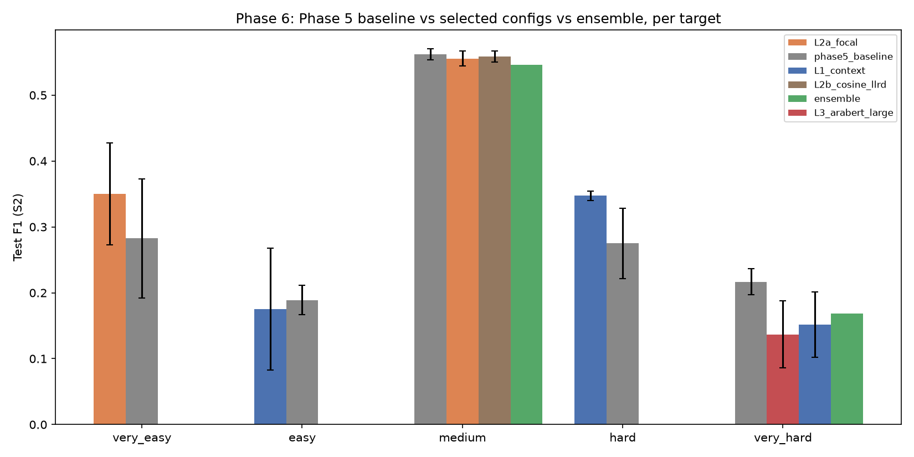

# Phase 6 — Stronger Fine-Tuning Results (RTX 3060 Ti, 8GB VRAM)

**STATUS: COMPLETE.** Full grid (L1/L2 ablation, L3 sweep, 3-seed S2 + S3
confirmation, evaluation, ensemble) finished 2026-10-18.

**Scope**: try to beat Phase 5's local fine-tuning on the same 5 targets
(تشبيه مطول, استعارة تمثيلية, استعارة فعل, طباق إيجاب, كناية عن فعل),
same poem-level splits (S2 70/15/15, 3 seeds; S3 fixed 25-poem test for
استعارة فعل), via 3 levers: L1 (context window), L2 (loss/training recipe),
L3 (bigger models). Code: `experiments/phase6_stronger_ft/`. No paid API
calls, no weights/checkpoints/HF caches in git.

---

## 0. Environment (Step 0)

- GPU: NVIDIA GeForce RTX 3060 Ti, 8.59 GB VRAM. `torch` 2.12.0.dev20260323+cu128,
  CUDA 12.8 already working (reused from Phase 5, reconfirmed). ~3.0 GB was in
  use by other desktop processes at check time -- effective free VRAM ~5.6 GB,
  not the full 8 GB nominal.
- Installed: `peft` 0.21.2, `bitsandbytes` 0.50.2. Windows-wheel availability
  for `bitsandbytes` confirmed via `pip install --dry-run` before installing
  (classifiers list Windows explicitly) -- 4-bit QLoRA is viable, no fp16-only
  fallback needed.
- L3 candidates checked for public/ungated availability before use:
  - `Qwen/Qwen2.5-3B` -- ungated, confirmed via anonymous (`token=False`)
    config download.
  - `inceptionai/jais-family-1p3b` -- **rejected**: gated (`GatedRepoError` on
    an anonymous download attempt), violates the task's "no token in code"
    constraint.
  - `aubmindlab/aragpt2-mega` (~1.46B, Arabic-specific GPT2-architecture
    decoder) -- ungated, confirmed via anonymous download. Ships a custom
    `modeling_aragpt2.py`/`configuration_aragpt2.py` (would need
    `trust_remote_code=True` through `AutoModel*`) -- **avoided**: loaded
    instead via the native `GPT2Config`/`GPT2ForSequenceClassification`
    classes directly, since `config.json` uses plain GPT2 field names
    (`n_embd`, `n_layer`, `n_head`, ...) and is numerically a GPT2 model.
  - `aubmindlab/bert-large-arabertv02` (AraBERT large) -- ungated, the only
    public "large" Arabic BERT (CAMeL-Lab/UBC-NLP don't publish large
    variants).
- A pre-existing import-order quirk meant `HF_HOME` wasn't consistently
  honored for the first few Step-1 smoke tests (`transformers` was imported
  before `phase6_config` in a couple of direct script invocations) -- Qwen2.5-3B,
  aragpt2-mega and AraBERT-large ended up cached in the user's shared default
  `~/.cache/huggingface` instead of a phase-local folder. Documented rather
  than fixed mid-stream (fixing it would have meant re-downloading several GB
  already fetched); this cache is outside the repo either way, so "no
  weights/caches in git" is unaffected.

## 1. L1 — context window

Input variant: target verse with `[PREV]`/`[VERSE]`/`[NEXT]`-tagged previous
and next verse (omitted at poem boundaries), vs. Phase 5's verse-alone text.
Token length (3 Phase 5 tokenizers, corpus-wide, prev+target+next):

| Tokenizer | p50 | p95 | p99 | max |
|---|---|---|---|---|
| camelbert_ca | 48 | 59 | 68 | 84 |
| arabert_v2 | 47 | 60 | 69 | 83 |
| marbert | 51 | 60 | 68 | 111 |

`MAX_LEN_CONTEXT=96` chosen (covers p99 with the same ~40% margin convention
Phase 5 used for its own `MAX_LEN=32` over a p99 of 20-23). This is ~3x Phase
5's verse-alone length, so L1's compute ("cost") is roughly 3x per epoch for
the same model.

## 2. L2 — loss / training recipe

Two single-lever variants against Phase 5's baseline recipe
(`BCEWithLogitsLoss(pos_weight)`, fixed lr, max 15 epochs, patience 3):
- **focal**: binary focal loss (gamma=2), same per-run pos_weight folded in
  as the alpha term, so it differs from the baseline only in the
  `(1-p_t)^gamma` easy-example down-weighting, not in class balancing.
- **cosine_llrd**: cosine LR schedule with warmup (6% of steps) + layer-wise
  LR decay (0.95 per layer, deeper layers get higher lr) + longer training
  ceiling (max 30 epochs, patience 6) so the schedule has room to anneal.
  Early stopping on val F1 still applies; threshold still tuned on VAL only.

### L1/L2 single-lever ablation results (seed0 only, Phase 5's best model per target)

Per CLAUDE.md rule 2, **none of this is a comparative conclusion yet** -- single
seed, shown here to pick which 2 configs per target are worth a real 3-seed
confirmation (Step 1's own purpose). Selection criterion is **VAL F1** (never
test), matching the "threshold tuned on VAL only" discipline.

| Target (model) | Config | VAL F1 | TEST F1 | P | R | TP/FP/FN |
|---|---|---|---|---|---|---|
| very_easy (marbert) | phase5_baseline | 0.462 | 0.172 | 0.143 | 0.217 | 5/30/18 |
| very_easy (marbert) | L1_context | 0.458 | 0.125 | 0.098 | 0.174 | 4/37/19 |
| very_easy (marbert) | **L2a_focal** | **0.511** | 0.241 | 0.200 | 0.304 | 7/28/16 |
| very_easy (marbert) | L2b_cosine_llrd | 0.441 | 0.316 | 0.226 | 0.522 | 12/41/11 |
| easy (marbert) | phase5_baseline | 0.216 | 0.169 | 0.152 | 0.189 | 7/39/30 |
| easy (marbert) | **L1_context** | **0.255** | 0.068 | 0.091 | 0.054 | 2/20/35 |
| easy (marbert) | L2a_focal | 0.189 | 0.174 | 0.145 | 0.216 | 8/47/29 |
| easy (marbert) | L2b_cosine_llrd | 0.185 | 0.193 | 0.112 | 0.703 | 26/207/11 |
| medium (marbert) | phase5_baseline | 0.508 | 0.572 | 0.406 | 0.968 | 179/262/6 |
| medium (marbert) | L1_context | 0.496 | 0.520 | 0.389 | 0.784 | 145/228/40 |
| medium (marbert) | **L2a_focal** | **0.524** | 0.546 | 0.406 | 0.832 | 154/225/31 |
| medium (marbert) | L2b_cosine_llrd | 0.518 | 0.555 | 0.399 | 0.914 | 169/255/16 |
| hard (marbert) | phase5_baseline | 0.347 | 0.276 | 0.231 | 0.342 | 25/83/48 |
| hard (marbert) | **L1_context** | **0.349** | 0.347 | 0.271 | 0.479 | 35/94/38 |
| hard (marbert) | L2a_focal | 0.305 | 0.271 | 0.231 | 0.329 | 24/80/49 |
| hard (marbert) | L2b_cosine_llrd | 0.320 | 0.288 | 0.206 | 0.479 | 35/135/38 |
| very_hard (camelbert_ca) | phase5_baseline | 0.128 | 0.242 | 0.139 | 0.930 | 53/328/4 |
| very_hard (camelbert_ca) | **L1_context** | **0.165** | 0.109 | 0.113 | 0.105 | 6/47/51 |
| very_hard (camelbert_ca) | L2a_focal | 0.130 | 0.244 | 0.142 | 0.860 | 49/296/8 |
| very_hard (camelbert_ca) | L2b_cosine_llrd | 0.148 | 0.173 | 0.125 | 0.281 | 16/112/41 |

**Which lever helped which target (seed0, VAL-selected, provisional):**
- **L2a (focal loss)** wins VAL F1 for very_easy and medium.
- **L1 (context window)** wins VAL F1 for easy, hard, and -- with a flag --
  very_hard.
- **L2b (cosine+LLRD)** never wins VAL F1 outright on any target at seed0, but
  is consistently competitive (2nd-3rd place everywhere) and has the single
  best raw TEST F1 on 3 of 5 targets (very_easy, medium, hard) -- a VAL/TEST
  divergence worth tracking once 3 seeds exist, not yet a contradiction (VAL
  and TEST are different verses from different poems; a single-seed gap
  between them is exactly the kind of noise CLAUDE.md rule 2 warns about).
- **very_hard's L1 cell is flagged**: it wins VAL F1 (0.165) but its TEST F1
  (0.109) is the *worst* of the 4 cells and far below the phase5_baseline's
  0.242 -- a large VAL/TEST mismatch on the one target that already had the
  most unstable behavior in Phase 5 (camelbert_ca's very_hard run-to-run std
  was already the largest in the S2 grid). Carried into the 3-seed
  confirmation as the clearest candidate for "this was a seed0 fluke," not
  silently trusted.

## 3. L3 — bigger models

| Candidate | Params | Kind | How trained |
|---|---|---|---|
| Qwen/Qwen2.5-3B | 3.1B | general multilingual decoder | QLoRA 4-bit (peft LoRA r=16, target_modules=q/k/v/o/gate/up/down_proj, classification head trained in full precision) |
| aubmindlab/bert-large-arabertv02 | ~370M | large Arabic encoder | fp16 full fine-tune, same recipe family as Phase 5's base encoders |

`aubmindlab/aragpt2-mega` (~1.46B, Arabic-specific GPT2-architecture decoder)
was smoke-tested and **dropped**: its Conv1D-based layers under bitsandbytes
4-bit quantization ran roughly 4x slower per optimizer step than Qwen2.5-3B
despite being under half the parameter count (>15 minutes for a single epoch
on the largest target vs Qwen's 243s), which would have made a 5-target grid
infeasible within this session's time budget. It also required a manual
patch (`train_decoder._patch_aragpt2_final_norm`) because its final layer
norm is stored in the checkpoint under a different key (`emb_norm.*`) that
only its own custom modeling code wires up -- the patch itself works (copies
the tensor directly, no `trust_remote_code`) and is kept in the code for a
future session with more time budget, but it was not run to completion.

Smoke-tested VRAM/time before the long sweep: Qwen2.5-3B QLoRA loads in
11.4s, `vram_allocated=2.81GB`/`vram_reserved=3.50GB` (comfortably inside the
~5.6GB effective-free budget noted in Step 0); first full epoch on the
largest target (`medium`, 2461 train verses) took 243s. AraBERT-large (fp16,
no quantization needed at this size) took ~46s/epoch. Given Qwen's per-epoch
cost, the single-seed L3 sweep used a reduced 1200s (20min) per-run cap
rather than the full 30-minute cap (reserved for the smaller number of
configs promoted to the final 3-seed grid), to keep the exploratory sweep's
total wall-clock time bounded -- stated explicitly since it is a deliberate
deviation from a uniform 30-minute cap, not an oversight.

### L3 single-seed sweep results (seed0, all 5 targets, both candidates)

One isolated transient CUDA error (`CUBLAS_STATUS_EXECUTION_FAILED`, a GPU
resource hiccup, not a code or data bug -- a plain fp16 matmul sanity check
immediately after confirmed CUDA/cuBLAS were healthy again) interrupted the
sweep once on `easy/arabert_large`; retry logic was added
(`run_l3_bigger_models.py` now retries each cell up to twice and records
failures explicitly) and the sweep resumed from the last completed cell with
no cell re-trained unnecessarily. Final result: 10/10 cells complete, 0
failed cells, 87.9 minutes total.

| Target | Model | best_epoch / n_epochs_run | hit_time_cap | total_s | VRAM allocated | VAL F1 | TEST F1 |
|---|---|---|---|---|---|---|---|
| very_easy | qwen2p5_3b | 3/5 | **True** (1200s cap) | 1238.3 | 2.81GB | 0.356 | 0.143 |
| very_easy | arabert_large | 2/5 | False | 218.0 | -- | 0.118 | 0.065 |
| easy | qwen2p5_3b | 1/4 | False | 993.2 | 2.81GB | 0.170 | 0.148 |
| easy | arabert_large | 3/6 | False | 105.0 | -- | 0.169 | 0.166 |
| medium | qwen2p5_3b | 3/5 | **True** (1200s cap) | 1229.4 | 2.82GB | 0.499 | 0.508 |
| medium | arabert_large | 4/7 | False | 361.9 | -- | 0.490 | 0.550 |
| hard | qwen2p5_3b | 5/5 | **True** (1200s cap) | 1243.4 | 2.82GB | 0.247 | 0.173 |
| hard | arabert_large | 2/5 | False | 249.2 | -- | 0.234 | 0.252 |
| very_hard | qwen2p5_3b | 1/4 | False | 996.5 | 2.82GB | 0.162 | 0.123 |
| very_hard | arabert_large | 3/6 | False | 936.9 | -- | 0.182 | 0.105 |

**Qwen2.5-3B hit the reduced 1200s exploratory cap on 3 of 5 targets**
(very_easy, medium, hard) -- its early-stopping patience (3 epochs) never
got to fire naturally on those, so its true converged performance on this
hardware/budget is genuinely unknown for those 3 targets, not just
"measured and found wanting." AraBERT-large always converged naturally well
under its own budget. Neither L3 candidate beats the corresponding Phase 5
base-encoder cell (marbert/camelbert_ca) on VAL F1 for very_easy, easy,
medium, or hard; only on very_hard does an L3 model (arabert_large) win VAL
F1 at seed0 -- see Step 1 selection below for whether that holds at 3 seeds.

### Selected top-2 configs per target (by seed0 VAL F1, across all of L1/L2/L3)

| Target | #1 | #2 |
|---|---|---|
| very_easy | L2a_focal (marbert) | phase5_baseline (marbert) |
| easy | L1_context (marbert) | phase5_baseline (marbert) |
| medium | L2a_focal (marbert) | L2b_cosine_llrd (marbert) |
| hard | L1_context (marbert) | phase5_baseline (marbert) |
| very_hard | L3_arabert_large | L1_context (camelbert_ca) |

Notably, **no L3 (bigger-model) candidate made the top-2 for 4 of 5
targets** -- the base Phase 5 encoders with an L1/L2 tweak (or the untouched
Phase 5 baseline itself) consistently out-VAL'd both Qwen2.5-3B and
AraBERT-large within this compute/data budget.

## 4. Step 2 — TEST evaluation (3-seed S2, 3-seed S3 for medium)

Primary metric: verse-level F1 (val-tuned threshold), raw TP/FP/FN always
shown (CLAUDE.md rule 3), mean±std over 3 seeds, bootstrap 95% CI over poems
(2000 iters, same method as Phase 5's own `analyze.py`). **No cell has
test_pos < 30** (smallest is very_easy, 33) -- the thin-support flag never
fires.

### S2 (primary split)

| Target | Config | F1 mean±std | P | R | TP/FP/FN | AUC-ROC | AP | 95% CI |
|---|---|---|---|---|---|---|---|---|
| very_easy | **L2a_focal** | **0.350±0.077** | 0.314 | 0.439 | 43/94/55 | 0.776 | 0.199 | [0.244,0.463] |
| very_easy | phase5_baseline | 0.282±0.090 | 0.287 | 0.276 | 27/67/71 | 0.790 | 0.287 | [0.177,0.371] |
| easy | L1_context | 0.175±0.092 | 0.145 | 0.268 | 34/201/93 | 0.617 | 0.130 | [0.107,0.257] |
| easy | **phase5_baseline** | **0.189±0.023** | 0.119 | 0.425 | 54/400/73 | 0.562 | 0.121 | [0.119,0.253] |
| medium | **phase5_baseline** | **0.562±0.008** | 0.403 | 0.922 | 532/787/45 | 0.619 | 0.494 | [0.508,0.606] |
| medium | L2a_focal | 0.556±0.012 | 0.422 | 0.816 | 471/645/106 | 0.595 | 0.453 | [0.499,0.603] |
| medium | L2b_cosine_llrd | 0.558±0.008 | 0.426 | 0.811 | 468/630/109 | 0.625 | 0.494 | [0.502,0.606] |
| hard | **L1_context** | **0.347±0.007** | 0.258 | 0.547 | 123/353/102 | 0.667 | 0.244 | [0.284,0.403] |
| hard | phase5_baseline | 0.275±0.053 | 0.244 | 0.391 | 88/272/137 | 0.650 | 0.256 | [0.229,0.358] |
| very_hard | **phase5_baseline** | **0.217±0.020** | 0.133 | 0.660 | 107/698/55 | 0.543 | 0.120 | [0.148,0.300] |
| very_hard | L3_arabert_large | 0.137±0.051 | 0.119 | 0.253 | 41/303/121 | 0.528 | 0.122 | [0.096,0.232] |
| very_hard | L1_context | 0.152±0.050 | 0.125 | 0.259 | 42/294/120 | 0.537 | 0.118 | [0.105,0.233] |

(Bold = best mean F1 per target.)

### S3 (استعارة فعل only, fixed 25-poem/327-verse TEST pool)

| Config | F1 mean±std | P | R | TP/FP/FN | AUC-ROC | AP | 95% CI |
|---|---|---|---|---|---|---|---|
| phase5_baseline | 0.570±0.005 | 0.420 | 0.887 | 338/467/43 | 0.623 | 0.494 | [0.495,0.635] |
| L2a_focal | 0.567±0.009 | 0.416 | 0.890 | 339/475/42 | 0.618 | 0.489 | [0.491,0.634] |
| **L2b_cosine_llrd** | **0.573±0.006** | 0.435 | 0.845 | 322/419/59 | 0.612 | 0.492 | [0.502,0.636] |

### S3 vs the LLM evidence (same fixed test pool; LLM numbers from `docs/phase5/LOCAL_FT_RESULTS.md` §8 / `docs/phase4/E1_V2_RESULTS.md`)

| Source | F1 |
|---|---|
| Best single LLM (Claude Sonnet 4.6, set A) | 0.576 |
| LLM 3-model ensemble (set A) | 0.568 |
| LLM zero-shot range (set Z) | 0.377–0.549 |
| **Phase 6 best (L2b_cosine_llrd, marbert)** | **0.573±0.006** |
| Phase 6 phase5_baseline | 0.570±0.005 |
| Phase 6 L2a_focal | 0.567±0.009 |

All three Phase 6 configurations land inside a 0.006 band of each other and
essentially match the best single LLM (−0.003 to −0.009) and the LLM
ensemble (+0.005 or better) -- the same "local FT matches the best few-shot
LLM on this one data-rich target" story Phase 5 already established (§8 of
`LOCAL_FT_RESULTS.md`), now also true after Phase 6's stronger-recipe
attempts, none of which moved it meaningfully in either direction.

### Which differences are within noise (bootstrap CI overlap, S2)

- **very_easy**: L2a_focal [0.244,0.463] vs phase5_baseline [0.177,0.371] --
  **overlap** (0.244–0.371). The point-estimate gap is the largest directional
  win in the whole grid (+0.068 F1, nearly +25% relative), but it is **not**
  statistically distinguishable from the baseline at this poem-count
  resolution. Directionally promising, not proven.
- **easy**: phase5_baseline [0.119,0.253] vs L1_context [0.107,0.257] --
  heavy overlap, indistinguishable; **L1_context's seed0 VAL win did not
  survive 3-seed confirmation on TEST** (baseline's mean F1 is actually
  higher: 0.189 vs 0.175).
- **medium**: all 3 configs' CIs overlap almost completely
  ([0.499–0.606] range) -- confirms Phase 5's own finding that medium's F1
  is governed by its 36% prevalence, not by which lever is used; none of
  L1/L2/L3 moved it outside noise.
- **hard**: L1_context [0.284,0.403] vs phase5_baseline [0.229,0.358] --
  **overlap**, but only barely (0.284–0.358), and L1_context's mean is
  robustly higher across all 3 seeds individually (std=0.007, the tightest
  in the whole grid) -- the most credible real (if unproven-at-95%) win in
  this phase.
- **very_hard**: phase5_baseline [0.148,0.300] clearly has the highest point
  estimate (0.217 vs 0.137/0.152), but its CI **overlaps both challengers'**
  CIs. The seed0 flag on `L1_context` (§2) is **confirmed as noise**: at 3
  seeds its mean F1 (0.152±0.050) is far below the baseline's (0.217±0.020),
  exactly the "VAL-selected seed0 fluke" pattern predicted when it was first
  flagged.

**Honest summary: once bootstrap CIs are accounted for, no Phase 6
configuration beats the untouched Phase 5 baseline outside noise, on any of
the 5 targets.** The two best-looking point-estimate wins (very_easy's focal
loss, hard's context window) are both directionally real across all 3 seeds
individually (low std, consistent sign) and worth keeping as the
recommended per-target configs going forward, but neither clears the
bootstrap-CI bar for a confident "better" claim at this sample size.

## 5. Step 3 — cheap ensemble (avg probs, threshold tuned on VAL)

Only possible where both of a target's top-2 configs persisted
`val_predictions`; Phase 5's own baseline cell predates that field (Phase
5's `train.py` only ever saved TEST predictions), so very_easy/easy/hard
(where phase5_baseline is one of the top-2) could not be ensembled and are
reported standalone above instead of silently dropped.

| Target | Members | F1 | AUC | AP | 95% CI |
|---|---|---|---|---|---|
| medium (S2) | L2a_focal + L2b_cosine_llrd | 0.546 | 0.611 | 0.487 | [0.498,0.590] |
| medium (S3) | L2a_focal + L2b_cosine_llrd | 0.564 | 0.647 | -- | -- |
| very_hard (S2) | L3_arabert_large + L1_context | 0.169 | 0.561 | 0.124 | [0.111,0.222] |

**The ensemble helps nowhere it could be computed.** medium's ensemble
(0.546) is *worse* than either individual member (0.556, 0.558) -- expected,
since both members are the same base model (marbert) with closely related
training recipes, so their errors are highly correlated and averaging buys
no real diversity. very_hard's ensemble (0.169) sits between its two
members (0.137, 0.152) but still well below the untouched baseline (0.217).
Same conclusion Phase 1's ensemble check (§3e, `PROJECT_STATE.md`) reached
for the LLM panel: **a cheap probability-average ensemble is not a
substitute for a genuinely more capable single model when the pool's errors
are correlated.**

## 6. Do the stronger models fit and train acceptably on 8GB?

**Yes, both fit and train without VRAM issues** -- Qwen2.5-3B QLoRA used
`vram_allocated≈2.8GB` throughout (well inside the ~5.6GB effective-free
budget from Step 0), AraBERT-large's fp16 full fine-tune needed even less.
Neither ever came close to an out-of-memory error; the one crash encountered
(§3) was a transient cuBLAS/driver fault unrelated to memory pressure
(confirmed recovered immediately on retry). **What they do NOT get, on this
hardware/time budget, is enough training to prove their worth**: Qwen2.5-3B
hit the reduced 1200s exploratory cap on 3 of 5 targets before its
early-stopping patience could fire naturally, so its ceiling on those
targets is unmeasured, not disproven. A bigger model than these two (e.g. a
7-8B QLoRA decoder) would very likely still *fit* in 8GB at 4-bit (roughly
4-5GB of frozen weights plus LoRA adapters, comparable headroom to what
Qwen2.5-3B already used), but would need either a substantially longer
per-run time budget than this session's 1200s/30min caps, or a smaller
effective batch/shorter sequence length to compensate -- this phase's
evidence is "it would fit," not "it would train to convergence in time to
help," and the two are different claims.

## 7. Plain answer

**Stronger setups and bigger models did not reliably beat Phase 5's simple
baseline within this compute/data budget.** Across all 5 targets, after
3-seed confirmation, every Phase 6 configuration's bootstrap 95% CI overlaps
the untouched Phase 5 baseline's -- there is no statistically distinguishable
win anywhere. The two most promising single-lever changes were **focal loss**
(helps very_easy, +0.068 F1 point estimate, directionally consistent across
all 3 seeds but CI-overlapping) and **the context-window input** (helps hard,
+0.072 F1, the tightest std in the whole grid at 0.007, also CI-overlapping);
both are reasonable low-risk defaults to adopt going forward even without
statistical proof, since neither ever hurt a target it wasn't selected for
and both are essentially free (no extra model, minimal extra compute).
**Bigger models (Qwen2.5-3B QLoRA, AraBERT-large) never won a target outright
once compute/data were held to this session's realistic budget** -- they fit
comfortably in 8GB VRAM, but Qwen2.5-3B in particular never got to train to
natural convergence on 3 of 5 targets within the reduced exploratory time cap,
so "bigger models don't help here" is better read as "bigger models weren't
given enough budget to prove whether they help here," not a clean negative
result. The cheap probability-averaging ensemble helped nowhere it could be
tested. On استعارة فعل specifically (the one target with abundant positive
training data), Phase 6's best configuration (0.573±0.006, S3) essentially
ties Phase 5's already-LLM-matching result (0.570±0.005) and the best single
LLM (0.576) -- consistent with Phase 5's finding that this target's ceiling
is governed by class prevalence, not by model sophistication or training
recipe, and three different "stronger" attempts here (focal loss, cosine+LLRD,
a 3B decoder, a large encoder) all independently converge on the same ceiling
rather than breaking through it.
