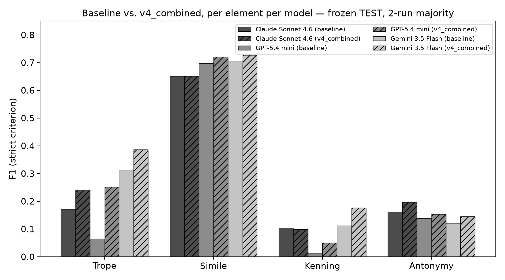
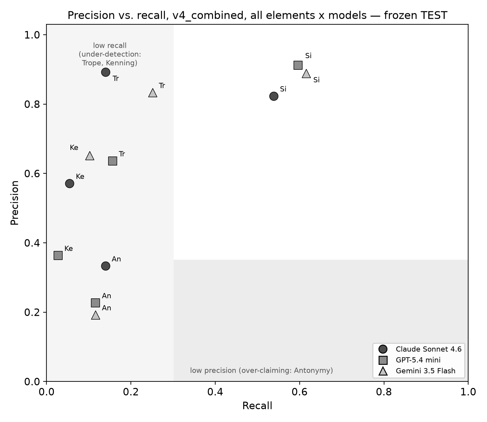
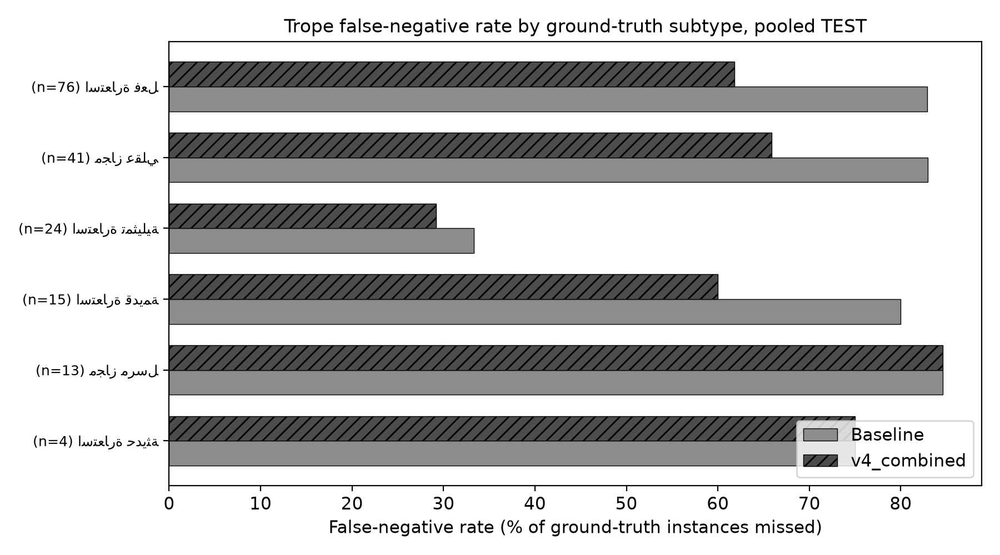
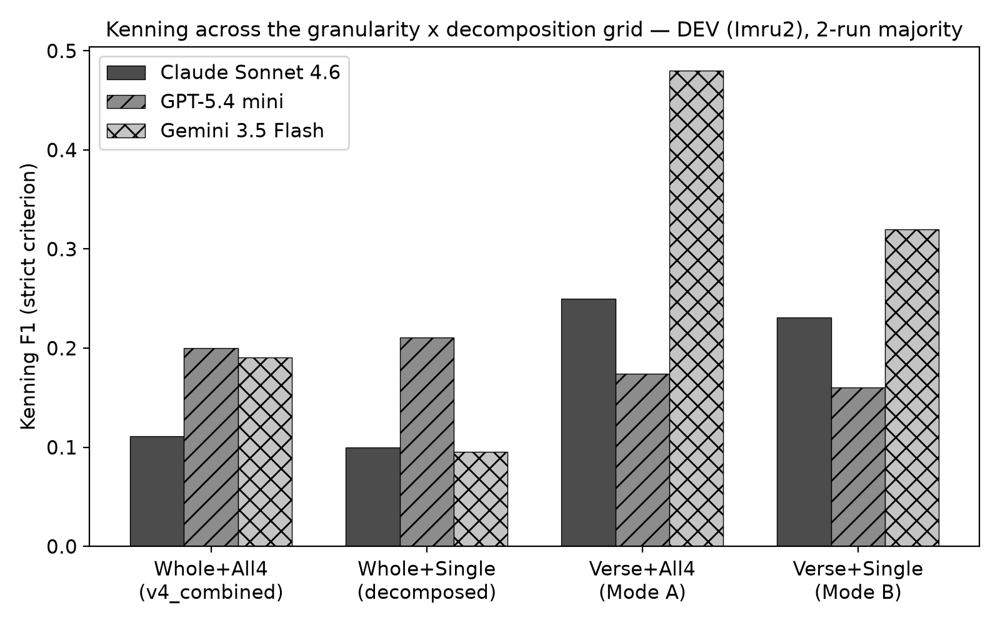

# Results

## 1. Overview

This chapter reports the frozen test-set evaluation of `v4_combined` against the baseline prompt (§1-§2), a set of secondary analyses conducted on the same frozen data (§3-§5), two supplementary experiments conducted on the development set only and explicitly not part of the frozen evaluation (§6-§7), an illustrative, unscored observation from a small explanation-augmented run (§8), and a cost-efficiency analysis across every configuration evaluated in this pilot cycle (§9). Full per-model true-positive/false-positive/false-negative counts for every number discussed in prose are collected in the appendix at the end of this chapter.

## 2. Frozen test-set results

Ground-truth support on the test set, pooled across its three poems (Imru' al-Qais's Mu'allaqa, Jarir, and Abu Tammam) after deduplication, is 179 trope instances, 52 simile instances, 147 kenning instances, and 43 antonymy instances.

<!-- source: PROJECT_STATE.md §3a; experiments/pilot_3models/ground_truth.py -->

Figure 1 summarizes strict-criterion F1 for both prompts, all three models, and all four elements. `v4_combined` improves on the baseline for every model on trope, simile, and antonymy, and is essentially flat on kenning. The improvement on trope is the clearest and most consistent finding in the frozen evaluation: all three models improve, and GPT-5.4-mini's trope F1 nearly quadruples (0.065 to 0.251), the largest single relative change observed anywhere in the frozen evaluation. Simile is already the element every model handles best under the baseline prompt (F1 0.65-0.70) and the refined prompt produces a small further gain for two of the three models, leaving Claude Sonnet 4.6 unchanged. Antonymy improves modestly for all three models under the strict criterion, and substantially more under the token-overlap criterion (§4). Kenning remains, by a wide margin, the hardest element for every model under both prompts, and is the one element `v4_combined`'s three added rules do not meaningfully move.

**Figure 1.** Baseline vs. v4_combined, strict-criterion F1 per element per model, frozen TEST, 2-run majority. (`../figures/f1_test_baseline_vs_v4.pdf` for print-quality vector version.)

Table 1 gives the same comparison as precision, recall, and F1 under the strict overlap criterion, without the underlying counts (given in the appendix).

<!-- source: experiments/pilot_3models/test_report.py:pooled_counts, re-executed for this chapter -->
**Table 1.** Strict-criterion precision/recall/F1, baseline vs. v4_combined, pooled TEST.

| Element | Model | Baseline P/R/F1 | v4_combined P/R/F1 |
|---|---|---|---|
| Trope | Claude Sonnet 4.6 | 0.85 / 0.09 / 0.171 | 0.89 / 0.14 / 0.242 |
| Trope | GPT-5.4-mini | 0.86 / 0.03 / 0.065 | 0.64 / 0.16 / 0.251 |
| Trope | Gemini 3.5 Flash | 0.89 / 0.19 / 0.313 | 0.83 / 0.25 / 0.386 |
| Simile | Claude Sonnet 4.6 | 0.82 / 0.54 / 0.651 | 0.82 / 0.54 / 0.651 |
| Simile | GPT-5.4-mini | 0.88 / 0.58 / 0.698 | 0.91 / 0.60 / 0.721 |
| Simile | Gemini 3.5 Flash | 0.82 / 0.62 / 0.703 | 0.89 / 0.62 / 0.727 |
| Kenning | Claude Sonnet 4.6 | 0.80 / 0.05 / 0.102 | 0.57 / 0.05 / 0.099 |
| Kenning | GPT-5.4-mini | 0.20 / 0.01 / 0.013 | 0.36 / 0.03 / 0.051 |
| Kenning | Gemini 3.5 Flash | 0.69 / 0.06 / 0.113 | 0.65 / 0.10 / 0.176 |
| Antonymy | Claude Sonnet 4.6 | 0.26 / 0.12 / 0.161 | 0.33 / 0.14 / 0.197 |
| Antonymy | GPT-5.4-mini | 0.27 / 0.09 / 0.138 | 0.23 / 0.12 / 0.154 |
| Antonymy | Gemini 3.5 Flash | 0.17 / 0.09 / 0.121 | 0.19 / 0.12 / 0.145 |

## 3. Run-to-run consistency

Every configuration above was run twice per model, and Table 1 reports the 2-run majority decision throughout. Decision-level agreement between the two runs — the fraction of verse-element checks on which both runs agree — is 88-100% under the baseline prompt and 89-100% under `v4_combined`, across all four elements and three models. Gemini 3.5 Flash's baseline behavior was perfectly deterministic on the test set for every element (100% agreement); the refined prompt's added rules cost some of that determinism, most visibly on kenning, where Gemini's agreement drops to 89%. GPT-5.4-mini is the least deterministic model under the baseline prompt on trope specifically (88% agreement), which recovers to 89% under the refined prompt — comparable to Gemini's kenning behavior after refinement, and the only two element-model combinations that fall meaningfully below 90% agreement anywhere in the frozen evaluation.

<!-- source: PROJECT_STATE.md §3b; experiments/pilot_3models/test_report.py:print_run_agreement -->

## 4. The token-overlap criterion and antonymy

The strict and token-overlap criteria agree closely for trope, simile, and kenning, but diverge substantially for antonymy: baseline token-criterion F1 is 0.419 (Claude), 0.345 (GPT), and 0.545 (Gemini), against 0.161, 0.138, and 0.121 under the strict criterion for the same three models; the gap persists, somewhat narrowed, under `v4_combined` (0.393, 0.431, 0.609 token-criterion against 0.197, 0.154, 0.145 strict). This divergence is attributable to Arabic morphological variation: a model frequently identifies the correct antonymy pair using an inflected form of the same root the ground-truth span uses (for example النُّوّامِ against the ground truth's نَوَّمُوا), which the token-overlap criterion — matching at the word level, with a partial correction for attached clitics — recovers but the strict literal-substring criterion does not. This is the primary reason both criteria are reported throughout this thesis rather than one being treated as authoritative.

<!-- source: PROJECT_STATE.md §3a; experiments/pilot_3models/span_matching.py -->

A second, independent antonymy finding, visible only at test scale (DEV's five-instance antonymy support was too thin to expose it), is that all three models systematically over-claim antonymy: under the baseline prompt, false positives exceed true positives for every model (Claude: 5 true positives against 14 false positives, for a strict-criterion precision of 0.263; GPT and Gemini show the same pattern with precision at 0.267 and 0.174 respectively). Figure 4 plots precision against recall for all four elements and three models together, and antonymy is visibly the only element sitting in the low-precision region of that plot — the opposite failure mode from trope and kenning, both of which sit in the low-recall, comparatively higher-precision region (models under-detect trope and kenning rather than over-claiming them).

**Figure 4.** Precision vs. recall, v4_combined, all elements x models, frozen TEST. (`../figures/f4_precision_recall_scatter.pdf` for print-quality vector version.)
<!-- source: PROJECT_STATE.md §3d -->

## 5. Trope subtype analysis and the ensemble check

Ground-truth trope instances on the test set carry a secondary subtype label from the original 53-category taxonomy. Pooling the false-negative rate by subtype across all three models reveals which kinds of trope `v4_combined` actually fixed. Figure 2 plots the six subtypes with at least four test-set instances; Table 2 gives the same figures.

**Figure 2.** Trope false-negative rate by ground-truth subtype, pooled TEST. (`../figures/f2_trope_subtype_miss_rates.pdf` for print-quality vector version.)
<!-- source: PROJECT_STATE.md §3c; experiments/pilot_3models/test_report.py:trope_subtype_breakdown, re-executed for this chapter -->
**Table 2.** Trope false-negative rate by ground-truth subtype, pooled across all three models, TEST.

| Subtype | n | Baseline missed | v4_combined missed |
|---|---|---|---|
| استعارة فعل (verbal metaphor) | 76 | 83% | 62% |
| مجاز عقلي (rational trope) | 41 | 83% | 66% |
| استعارة تمثيلية (unmarked whole-clause allegory) | 24 | 33% | 29% |
| استعارة قديمة (archaic/lexicalized) | 15 | 80% | 60% |
| مجاز مرسل (metonymy, single lexicalized word) | 13 | 85% | 85% |
| استعارة حديثة | 4 | 75% | 75% |

`v4_combined`'s genuine wins are on verbal metaphor and rational trope — the two subtypes its added boundary rule was designed to address (§4.2 of the methodology chapter) — while مجاز مرسل, a closed class of single, conventionalized lexical metonyms, is the one subtype the refined prompt does not move at all. As discussed in the methodology chapter, a development-set-scale analysis on two poems had identified a different subtype (استعارة تمثيلية) as the hardest case; at test scale, on three poems and a larger instance count, استعارة تمثيلية is in fact the *easiest* subtype in the table, both before and after refinement. This reversal is treated as a caution about drawing subtype-level conclusions from a two-poem development sample rather than as a finding about استعارة تمثيلية itself.

A separate check evaluated whether combining all three models' predictions by majority vote improves on the best single model. Using majority-vote decisions across the three models against ground truth (computed once, on the original single-poem pilot data, requiring no additional API calls), ensemble F1 for trope (0.222) and kenning (0.167) is identical to the best individual model's score for that element — the three models miss the same instances rather than making independent errors an ensemble could average out. Ensemble simile F1 (0.667) is in fact worse than the best individual model (GPT-5.4-mini alone scores 0.769), since combining predictions trades away recall for precision on an element where the baseline models are already reasonably accurate. This is reported as evidence against assuming that panel-of-models prediction reliably improves recall on this task, at least for the three models and one poem tested here.

<!-- source: PROJECT_STATE.md §3e; experiments/pilot_3models/ensemble_check.py -->

## 6. Supplementary experiment: per-element decomposition (development set only)

Two further experiments were conducted specifically to probe whether kenning's continued difficulty was an artifact of the prompt's structure rather than of the task itself. Both were conducted on the development poems only, after the frozen test evaluation, and neither is part of the evaluation reported in §2-§5 above; both are reported here as negative or mixed findings, not as adopted techniques.

The first restructuring split `v4_combined` into four single-element prompts — one API call per element, each seeing only that element's definition and only the subset of the three added rules relevant to it — on the hypothesis that kenning might be suffering from competing for the model's attention against the other three elements within a single call. Pooled across both development poems, decomposition helped kenning for one of three models (Claude Sonnet 4.6: F1 0.130 to 0.190, achieved by trading precision for recall) and made it worse for the other two: Gemini's kenning F1 fell from the best score in the pooled comparison (0.244) to 0.173, and GPT-5.4-mini's positive call count collapsed from 15 to 4, precision rising to a hollow 1.00 while recall nearly halved and run-to-run agreement fell from 98% to 82% — the opposite of the determinism gain decomposition produced for every other element-model combination. This does not support a simple task-interference account of kenning's difficulty: two of three models performed worse, not better, when kenning was the only element a given call was asked to judge.

Trope fared better under decomposition (two of three models improved, one roughly doubling its F1), and the clearest decomposition effect across all elements was on run-to-run determinism rather than on accuracy: agreement rose for every model on trope, most sharply for GPT-5.4-mini (77% to 93%). Simile and antonymy, neither of which received an added rule under decomposition, moved in both directions across models on small counts and are not treated as informative either way.

<!-- source: PROJECT_STATE.md §3f; experiments/pilot_3models/decompose_report.py -->

## 7. Supplementary experiment: per-verse granularity and cross-poem replication (development set only)

The second restructuring changed call granularity rather than element scope: one API call per verse (crossed with both the combined all-four-element prompt and the decomposed single-element prompts), instead of one call for the entire poem, evaluated first on one development poem (Imru2, 23 verses) to complete a 2-by-2 design (whole-poem/per-verse crossed with all-elements/single-element). Figure 3 shows the resulting kenning grid for all three models.

**Figure 3.** Kenning F1 across the whole-poem/per-verse x all-element/single-element grid, DEV (Imru2), 2-run majority. (`../figures/f3_kenning_granularity_grid.pdf` for print-quality vector version.)

Per-verse calling with the combined all-element prompt produced the single largest effect observed anywhere in this pilot cycle: kenning F1 improved for two of three models, most dramatically for Gemini (whole-poem F1 0.190 to per-verse F1 0.480, a 152% relative increase) and Claude (0.111 to 0.250, a 125% increase), while GPT-5.4-mini was roughly flat. Combining per-verse calling with element decomposition, however, did not compound this gain — kenning F1 under the combined per-verse/decomposed configuration was lower than under per-verse calling alone for all three models — indicating that granularity and element-isolation are largely independent interventions whose effects do not stack.

Because this was the single largest apparent effect in the entire pilot cycle, and rested on one development poem with only 17 kenning instances, the same per-verse, all-element configuration was subsequently re-run on the second development poem (Nabigha, 52 kenning instances) specifically to check whether the effect size, not merely its direction, replicated.

<!-- source: PROJECT_STATE.md §3g -->
**Table 3.** Kenning strict-criterion F1, whole-poem versus per-verse calling, both development poems.

| Model | Imru2: whole → per-verse (Δ) | Nabigha: whole → per-verse (Δ) |
|---|---|---|
| Claude Sonnet 4.6 | 0.111 → 0.250 (+125%) | 0.136 → 0.338 (+149%) |
| GPT-5.4-mini | 0.200 → 0.174 (-13%) | 0.156 → 0.143 (-9%) |
| Gemini 3.5 Flash | 0.190 → 0.480 (+152%) | 0.262 → 0.290 (+11%) |

<!-- source: PROJECT_STATE.md §3g (Nabigha replication addendum) -->

The replication is genuinely mixed rather than uniformly negative or positive. Gemini's dramatic first-poem gain shrank by an order of magnitude on the second poem — a poem-level instance of the same effect-size instability the run-level majority-vote protocol was designed to catch (§6.4 of the methodology chapter) — while Claude's gain held, and if anything grew, on the second poem. GPT-5.4-mini is the one model with a consistent story across both poems: flat to slightly negative, never benefiting from per-verse calling. The direction of the effect — per-verse calling helps kenning — therefore replicates for two of three models across two poems, which is a genuine, non-trivial finding; the *magnitude* of any single model's reported gain does not replicate reliably and should not be quoted as if it generalizes. Set against this, per-verse calling costs four to eight times more per unit of F1 than whole-poem batching (§9), because the system prompt is re-sent on every single-verse call, and even its best per-model, per-poem result (Claude at 0.338 F1 on Nabigha) remains far below simile's typical ceiling of 0.65-0.70. On balance, this thesis does not recommend adopting per-verse calling as a technique, while reporting the underlying effect as real rather than illusory.

## 8. Illustrative observation: an explanation-augmented prompt

A small, unscored, illustrative extension of `v4_combined` was run on one development poem (Imru2), adding a required one-sentence Arabic justification field to the output schema for every positive decision, one run per model. This was never evaluated against ground truth for the correctness of any new positive call it produced, and is reported here only as a behavioral observation, not as an evaluated finding: comparing this run's decisions against the existing 2-run-majority `v4_combined` decisions on the same poem, 5 of 92 verse-element checks flipped for Claude, 14 of 92 for GPT-5.4-mini, and 2 of 92 for Gemini — and for all three models, every flip went from absent to present; none went the other way. Requiring a stated justification did not cause any model to retract an existing positive call in this sample; it only ever produced new ones. This is consistent with a justification-seeking generative effect rather than a self-correction effect, and is offered as a reason not to assume, without a properly scored follow-up, that an explanation-requiring prompt would improve precision on this task — in this illustrative sample it moved only the rate of positive calls, in a direction that is not known to be toward correct ones.

<!-- source: PROJECT_STATE.md §3i -->

## 9. Cost-efficiency analysis

Whole-poem batching — one API call covering an entire poem's worth of verses — is substantially more cost-efficient per unit of accuracy than the per-verse calling evaluated in §7, because the system prompt (which dominates the token count of any individual call under this pilot's prompt lengths) is paid for once per poem rather than once per verse. Using a support-weighted (micro) F1 across all four elements and three models on Imru2, whole-poem calling with the combined all-element prompt achieves an F1-per-dollar of approximately 2.1, against approximately 0.5 for per-verse calling with the same all-element prompt and approximately 0.3 for per-verse calling combined with element decomposition — a four-to-eight-fold gap that persists regardless of the accuracy comparison in §7.

<!-- source: PROJECT_STATE.md §3g (F1-per-dollar table); experiments/pilot_3models/per_verse_report.py -->

Total realized API expenditure across every configuration reported in this thesis — the original single-poem pilot, development-set prompt tuning and ablations, the frozen test evaluation, both supplementary development-set experiments including the cross-poem replication, and the illustrative explanation-augmented sample — is $8.29 across 1,134 individual model calls.

<!-- source: PROJECT_STATE.md §1 (final totals); computed programmatically from every run_manifest.json under results/pilot_3models/ -->

---

## Appendix: full TP/FP/FN counts, frozen TEST evaluation

<!-- source: experiments/pilot_3models/test_report.py:pooled_counts, re-executed for this chapter -->
| Element | Model | Baseline TP/FP/FN (strict) | Baseline TP/FP/FN (token) | v4_combined TP/FP/FN (strict) | v4_combined TP/FP/FN (token) |
|---|---|---|---|---|---|
| Trope | Claude Sonnet 4.6 | 17/3/162 | 17/3/162 | 25/3/154 | 26/2/153 |
| Trope | GPT-5.4-mini | 6/1/173 | 6/1/173 | 28/16/151 | 30/14/149 |
| Trope | Gemini 3.5 Flash | 34/4/145 | 35/3/144 | 45/9/134 | 46/8/133 |
| Simile | Claude Sonnet 4.6 | 28/6/24 | 32/2/20 | 28/6/24 | 32/2/20 |
| Simile | GPT-5.4-mini | 30/4/22 | 30/4/22 | 31/3/21 | 31/3/21 |
| Simile | Gemini 3.5 Flash | 32/7/20 | 33/6/19 | 32/4/20 | 32/4/20 |
| Kenning | Claude Sonnet 4.6 | 8/2/139 | 8/2/139 | 8/6/139 | 8/6/139 |
| Kenning | GPT-5.4-mini | 1/4/146 | 1/4/146 | 4/7/143 | 3/8/144 |
| Kenning | Gemini 3.5 Flash | 9/4/138 | 9/4/138 | 15/8/132 | 15/8/132 |
| Antonymy | Claude Sonnet 4.6 | 5/14/38 | 13/6/30 | 6/12/37 | 12/6/31 |
| Antonymy | GPT-5.4-mini | 4/11/39 | 10/5/33 | 5/17/38 | 14/8/29 |
| Antonymy | Gemini 3.5 Flash | 4/19/39 | 18/5/25 | 5/21/38 | 21/5/22 |
